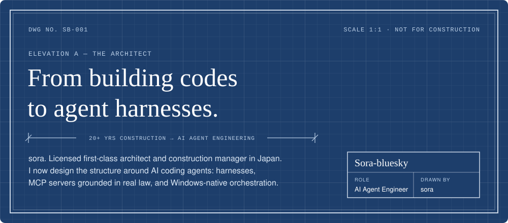

[English](README.md) | [日本語](README.ja.md)

  

  
  
  

<h2></h2>

1. **Harnesses and guardrails for AI coding agents.** Claude Code, Codex, and multi-agent orchestration on Windows.
2. **Domain × AI.** I hold Japanese first-class architect and construction management licenses, and build MCP servers that stop LLMs from hallucinating building codes and real-estate law.
3. **Windows-native developer experience.** Most agent tooling assumes Unix; mine doesn't.
4. **Writing.** I write about AI coding workflows in Japanese on [Substack](https://sorabiz.substack.com/) and [Zenn](https://zenn.dev/sora_biz).

<h2></h2>

| Mark | Project | Specification | Material |
|:---:|---|---|---|
| `W‑1` | [**winsmux**](https://github.com/Sora-bluesky/winsmux) | Windows-native terminal multiplexer for inter-agent communication. tmux-style orchestration without WSL | Rust |
| `W‑2` | [**kbd-signal**](https://github.com/Sora-bluesky/kbd-signal) | Status lamp for Claude Code / Codex sessions using VIA-compatible keyboard RGB. Glance at your keyboard, know your agent's state | Python |
| `S‑1` | [**building-standards-act-mcp**](https://github.com/Sora-bluesky/building-standards-act-mcp) | MCP server for the Japanese Building Standards Act via the e-Gov API. Verifies statutes at the source so AI answers cite real law | TypeScript |
| `W‑3` | [**security-loop**](https://github.com/Sora-bluesky/security-loop) | Matches installed versions on a Windows PC and a VPS against OSV, runtime advisories and CISA KEV. Re-checks impact claims on every scan | Python |
| `T‑1` | [**x-jimaku**](https://github.com/Sora-bluesky/x-jimaku) | Chrome extension that overlays live Japanese subtitles on x.com videos using local Whisper (WebGPU) and Chrome's built-in Translator API | TypeScript |
| `T‑2` | [**checkchart**](https://github.com/Sora-bluesky/checkchart) | Checks flowcharts, sequence diagrams and architecture diagrams for facts and readability before drawing them as Mermaid | TypeScript |

<h2></h2>

  
  
  
  
  

  
  
  
  
  

<h2></h2>

  
  

<h2></h2>

All my Zenn articles are available in English (auto-translated). Just add `?locale=en`:

- [tmux on Windows without WSL: pane splitting and parallel AI agents with Rust-made psmux](https://zenn.dev/sora_biz/articles/psmux-windows-native-tmux?locale=en)
- [Hermes Agent complete build guide: your own always-on AI agent on a VPS](https://zenn.dev/sora_biz/articles/hermes-vps-complete-guide?locale=en)
- [Stop searching your notes yourself: Hermes Agent reads Obsidian as its memory](https://zenn.dev/sora_biz/articles/hermes-vps-13-obsidian?locale=en)

More on [Zenn](https://zenn.dev/sora_biz) (Japanese / English) and [Substack](https://sorabiz.substack.com/) (Japanese).

  DMs open on <a href="https://x.com/sora_biz">X</a>. Happy to talk AI agent tooling, Windows dev experience, and architecture × AI.

